<h1 align="center">卧游 · Ink Peaks</h1>

<p align="center"><b>把地球上真实的山，画成一幅宋画。</b><br>
选一座山，浏览器就用它真实的地形画出一幅山水：层峦叠嶂、墨色晕染、云气缭绕，再题上款、钤上印。</p>

<p align="center">
  <a href="https://goldfish76.github.io/inkpeaks/"><b>打开 卧游 →</b></a> ·
  <a href="README.md">English</a>
</p>

<p align="center"><a href="https://goldfish76.github.io/inkpeaks/">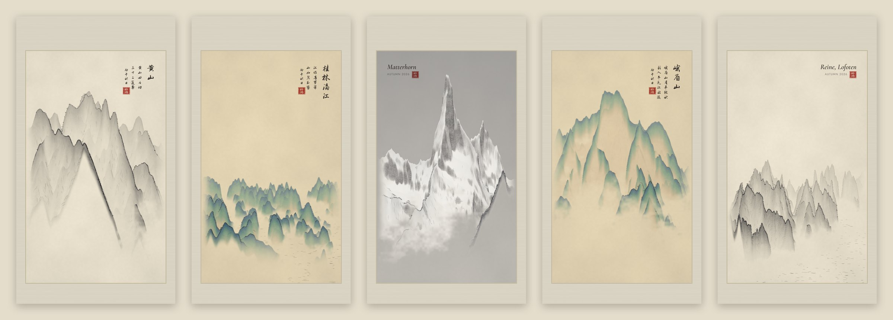</a></p>

“卧游”出自南朝宋的宗炳。他晚年老病，登不动山了，就把一生游历过的名山画在居室四壁，躺着看画，“卧以游之”。卧游 · Ink Peaks 从真实的山出发：它读取这个地方公开的高程数据，画里每一道山脊、每一条峡谷、每一座峰顶都真实存在，只有笔墨是画出来的。

## 能做什么

- **任何一座山**：28 座精选名山已经调好取景；也可以在 14,500 座有名字的山峰里搜索，或者直接输入经纬度、用你所在的位置。
- **三远构图**：依郭熙《林泉高致》。高远“自山下而仰山巅”，深远“自山前而窥山后”，平远“自近山而望远山”。
- **四种画法**：水墨、青绿、浅绛、雪景。
- **多种画幅**：立轴、横卷、斗方、团扇，还有手机壁纸；可以选择是否装裱。
- **题款**：竖排行书、楷书或草书，落款用干支纪年（如“丙午秋日”），再钤一方印。名山都配有相应的古诗。英文题款横排。
- **导出**：大尺寸 PNG（画面长边最大 5,400 像素），或可直接打印的 PDF（A4、A3、Letter）。画面的所有设置都在链接里，分享出去别人看到的就是同一幅画。
- **隐私**：画全部在你的设备上完成（Web Worker），不用注册，没有统计，不上传任何东西。

<p align="center">
  <a href="https://goldfish76.github.io/inkpeaks/#p=huangshan">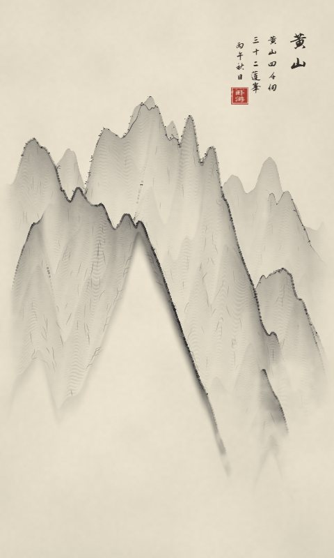</a>
  <a href="https://goldfish76.github.io/inkpeaks/#p=guilin">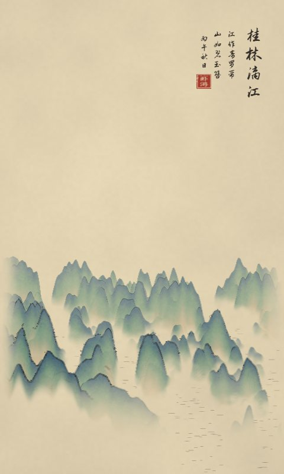</a>
  <a href="https://goldfish76.github.io/inkpeaks/#p=fuji">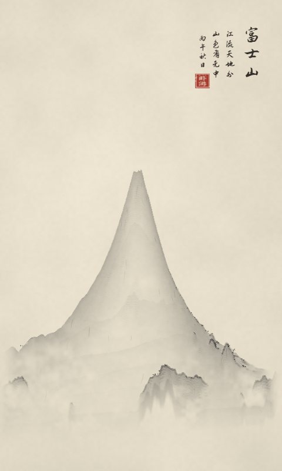</a>
</p>
<p align="center">
  <a href="https://goldfish76.github.io/inkpeaks/#p=matterhorn">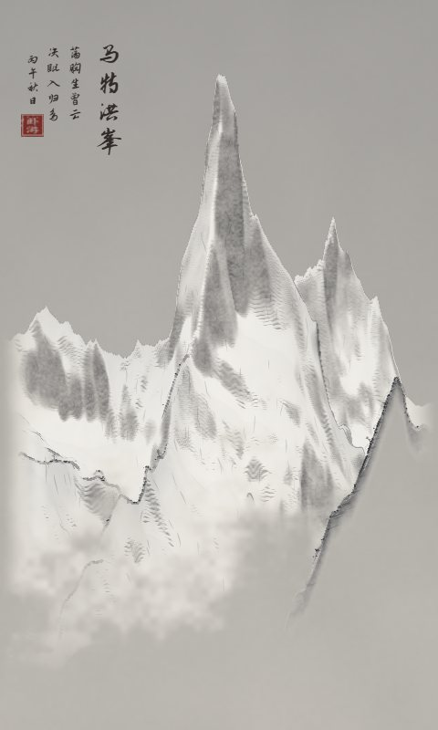</a>
  <a href="https://goldfish76.github.io/inkpeaks/#p=emeishan">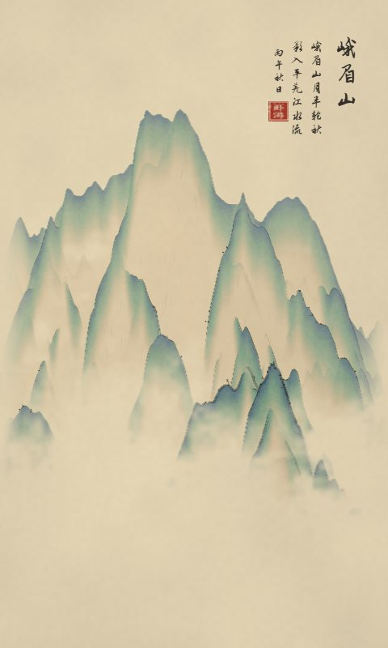</a>
  <a href="https://goldfish76.github.io/inkpeaks/#p=lofoten">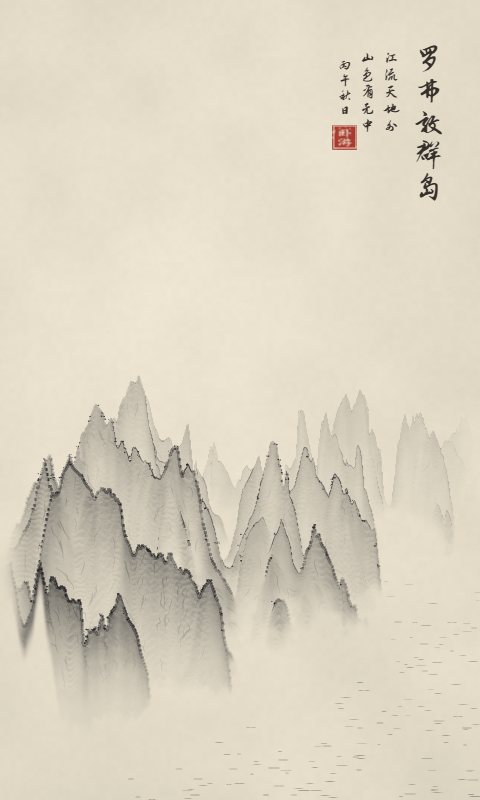</a>
</p>
<p align="center">
  <a href="https://goldfish76.github.io/inkpeaks/#p=huashan">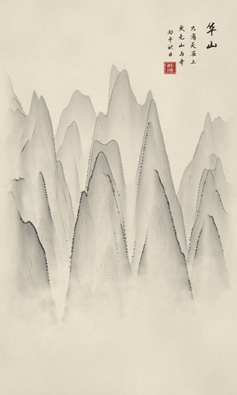</a>
  <a href="https://goldfish76.github.io/inkpeaks/#p=eiger">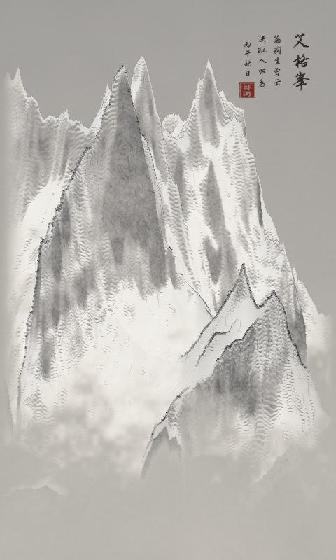</a>
  <a href="https://goldfish76.github.io/inkpeaks/#p=taishan">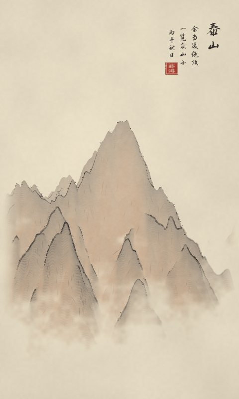</a>
</p>

<p align="center">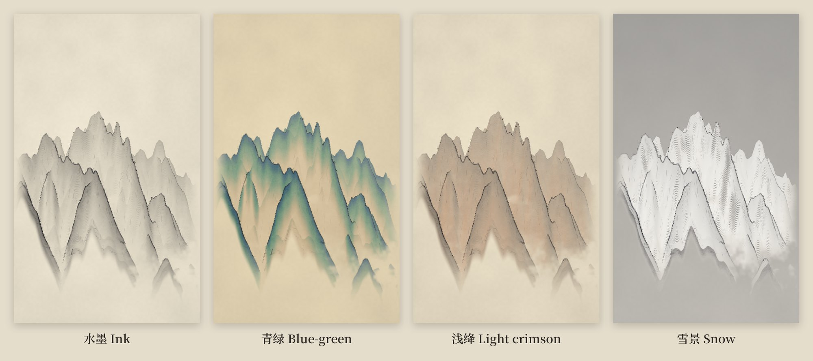</p>

<p align="center">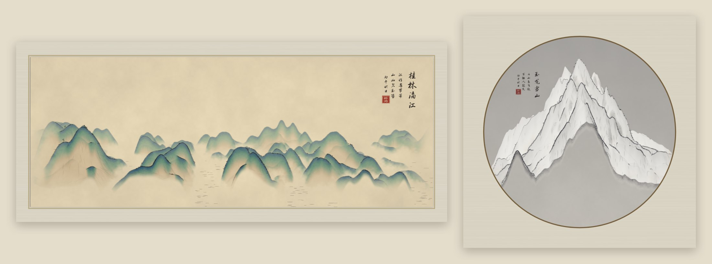</p>

## 怎么画出来的

<p align="center">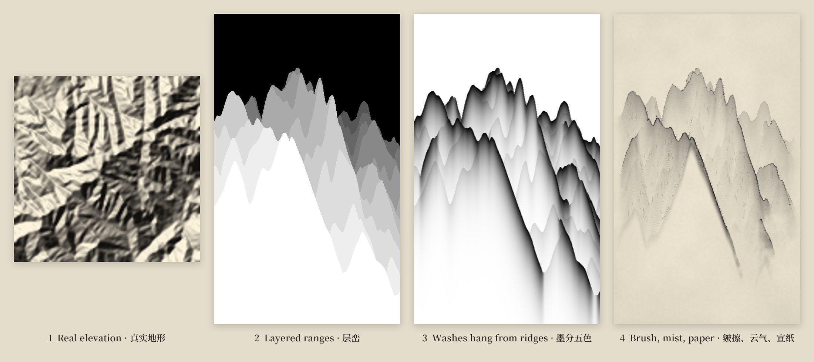</p>

宋人画山不是拍照片：一重山叠在另一重山后面，墨聚在山脊下面再往下渐淡，低处留给云气。卧游用真实地形照着这些习惯来画：

1. **真实地形**：取 Terrarium 编码的高程瓦片，重采样到正北朝上、以米为单位的网格上。28 座名山的地形已经随网站打包。
2. **层峦**：用“浮动地平线”把你面前的地面投影到画上：画面的每一列从近往远走，只留下比前面更高的部分。远处的地面被抬高、缩小，于是群山像立轴里那样一层层往上叠。景深切成若干带，每一带有自己的山脊线。
3. **墨分五色**：墨从每一道真正的轮廓线挂下来，往下渐淡。平缓的坡面会把上方山脊的墨色接着传下去，真正的轮廓线才另起一层。背光和陡峭处墨色更深，远山渐渐淡入空气。
4. **皴擦、云气、宣纸**：皴笔顺着坡向走，山脊勾线带飞白，再点苔点，近处山头添几棵松，水面画上波纹。云海填满山谷，云带横过中景，最后衬上有纤维的宣纸。青绿和浅绛在墨上再敷石色或赭石。
5. **题款、装裱**：题款放在天空更空的一侧，钤印，裱上绫边，画边用小字注明地形数据来源。

整个绘制程序（`js/paint/`）约 1,300 行原生 JavaScript，没有任何依赖。它在模块化 Web Worker 里用 `OffscreenCanvas` 作画，不支持时退回主线程。

## 在本地运行

不需要构建，也没有依赖，任何静态文件服务器都可以：

```bash
git clone https://github.com/Goldfish76/inkpeaks.git
cd inkpeaks
python -m http.server 8000
```

然后打开 <http://localhost:8000>。页面用的是 ES 模块，所以不能直接双击 `index.html` 打开。在 Chrome 中测试过。

```
index.html, css/        页面
js/app.js               界面、链接里的状态、导出
js/paint/               绘制程序：取景网格、投影、笔触、画法
js/terrain/             高程瓦片与数据署名
js/compose.js           题款、印章、装裱
js/worker.js            在后台线程里作画
data/                   名山、打包的地形、搜索用的山峰索引
fonts/                  自托管的字体子集（OFL）
tools/                  构建脚本、调试页（tools/dev.html）和渲染工具
```

`tools/` 里的脚本可以重新生成 `data/`、`fonts/`、`docs/` 和 `img/thumbs/` 下的全部文件，每个脚本开头都写了用法。

## 数据与致谢

地形来自 [Mapterhorn](https://mapterhorn.com/attribution)。它把 Copernicus DEM GLO-30（© DLR e.V. 2010–2014 and © Airbus Defence and Space GmbH 2014–2018, provided under COPERNICUS by the European Union and ESA）和各国的高程模型合在一起，比如 swisstopo、IGN、日本国土地理院、USGS、Kartverket、LINZ；取不到时改用 [AWS Terrain Tiles](https://registry.opendata.aws/terrain-tiles/)。每幅画的画边都会用一行小字注明地形数据来源。山名来自 [Wikidata](https://www.wikidata.org)（CC0）；书法字体是马善政楷书、志莽行书、龙藏体（SIL OFL）。完整清单见 [ATTRIBUTION.md](ATTRIBUTION.md)。

画中不含国界、地名与坐标。

## 另见

[那晚星空 · The Sky That Night](https://github.com/Goldfish76/the-sky-that-night)：选一个日期和地点，生成那一刻真实星空的海报，可以直接打印。

## 许可

代码：[MIT](LICENSE)。数据和字体各自保留原有许可，见 [ATTRIBUTION.md](ATTRIBUTION.md)。
